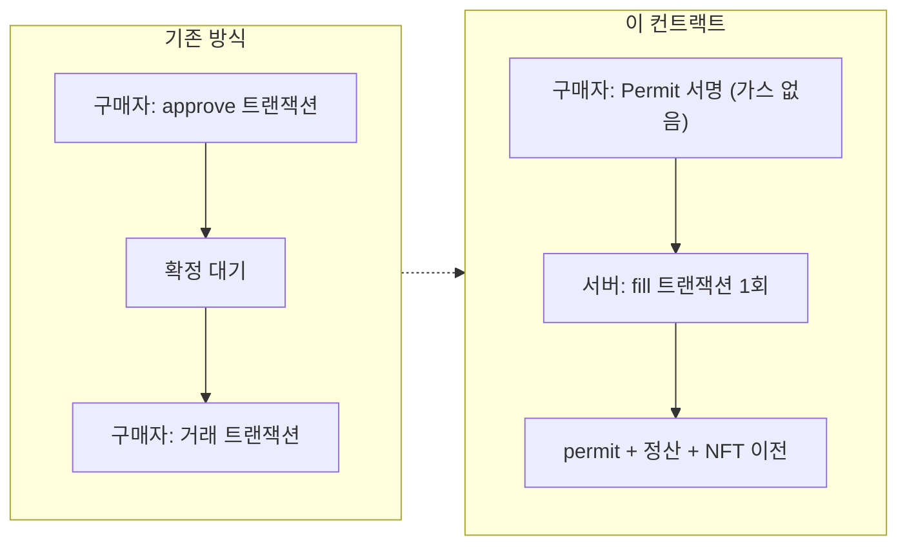
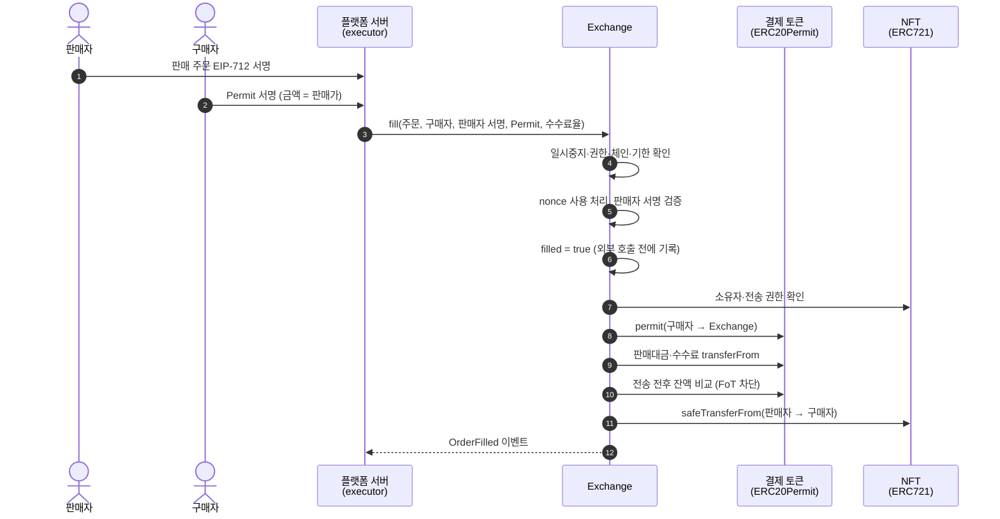
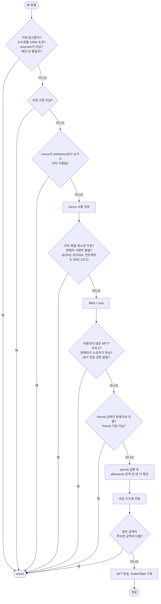

<!-- EIP-2612 Permit 기반 NFT 거래소 컨트랙트의 설계와 보안 장치를 설명하는 포트폴리오 README -->
# NFT Exchange Contract

ERC-20 토큰으로 NFT를 사고파는 거래소 컨트랙트입니다.

판매자와 구매자는 지갑에서 서명만 하고, 실제 트랜잭션은 플랫폼 서버(executor)가 한 번에 보냅니다. 구매자는 EIP-2612 Permit 서명으로 approve를 대신하니 따로 트랜잭션을 보낼 일도, 가스를 낼 일도 없습니다.

굿블록에 다니며(2025.09 ~ 2025.10) 직접 설계하고 작성해 BSC 테스트넷에 배포했습니다. `src/Exchange.sol`은 배포한 버전과 같은 파일입니다.

| 항목 | 내용 |
|---|---|
| 배포 주소 (BSC Testnet) | [`0x8AE469E8dE6d031B5915104343Ea49B2A32A6608`](https://testnet.bscscan.com/address/0x8AE469E8dE6d031B5915104343Ea49B2A32A6608#code) |
| 컴파일러 | Solidity 0.8.27 |
| 의존성 | OpenZeppelin Contracts 5.4.0 |
| 표준 | EIP-712, EIP-2612, ERC-1271 |

## 무엇이 달라졌나

예전에는 구매자가 결제 토큰을 `approve`한 뒤 거래를 따로 실행해야 했습니다. 트랜잭션이 두 번이라 가스도 두 번 들고, 첫 번째가 확정될 때까지 기다려야 했습니다.

이제 구매자는 Permit에 서명만 합니다. 서버가 `fill`을 호출하면 컨트랙트 안에서 `permit`과 정산을 함께 처리하므로 구매자가 보내는 트랜잭션은 없습니다.

## 거래 흐름

판매자는 거래 전에 한 번만 이 거래소에 NFT 전송 권한(`setApprovalForAll`)을 주면 됩니다. 그 뒤로는 판매도 구매도 서명만으로 끝납니다.

## fill이 확인하는 것

검사 하나만 실패해도 트랜잭션 전체가 되돌아갑니다. 체결 상태(`filled = true`)는 토큰과 NFT를 호출하기 전에 기록해 CEI 순서를 지켰습니다.

## 보안 장치

| 막으려는 것 | 막는 방법 |
|---|---|
| 재진입 | OpenZeppelin `ReentrancyGuard`를 걸고, 체결 상태를 외부 호출 전에 기록 (CEI) |
| 같은 주문의 이중 체결 | 판매자별 `nonceUsed`로 한 번 쓴 nonce를 막고, 주문 해시별 `filled`·`canceled`도 함께 확인 |
| 유출된 옛 주문 | 판매자가 `cancelAllUpTo`로 `minNonce`를 올리면 그보다 낮은 nonce의 주문은 한꺼번에 무효 |
| 다른 체인에서 서명 재사용 | 배포할 때 Chain ID를 저장하고 호출마다 비교 (`BadChain`) |
| 수수료를 떼는 토큰(FoT) | 전송 전후 잔액을 비교해 1이라도 모자라면 되돌림 (`FoTDetected`) |
| Permit만 믿는 위험 | `permit` 뒤에 allowance와 잔액을 다시 확인 |
| 컨트랙트 지갑 판매자 | 판매자가 컨트랙트면 ERC-1271 `isValidSignature`로 검증 |
| 아무 NFT나 거래됨 | `allowedNft` 화이트리스트에 등록된 컬렉션만 거래 |
| 소유권 실수 이전 | `Ownable2Step`이라 새 소유자가 수락해야 넘어감 |
| 운영 중 사고 | 거래와 취소를 따로 멈추는 스위치 (`setTradingPaused`, `setCancelPaused`) |

## 주문 취소

상황에 맞게 네 가지 방법으로 취소합니다.

| 함수 | 호출할 수 있는 쪽 | 쓰는 때 |
|---|---|---|
| `cancel` | 판매자, executor, owner | 주문 내용 전체를 알고 있을 때 |
| `cancelByHash` | executor, owner | 주문 해시만 있을 때 (운영 정책, 보안 사고 대응) |
| `cancelWithSig` | executor (판매자 서명 필요) | 판매자가 가스 없이 취소를 요청할 때 |
| `cancelAllUpTo` | 판매자 | 특정 nonce 이전 주문을 한 번에 무효로 만들 때 |

취소 사유는 `CancelReason` 코드로 이벤트에 남깁니다.

## 그 밖의 기능

- **`transferWithPermit`**: NFT 거래가 아니어도 Permit 서명으로 ERC-20을 옮깁니다. 서버가 사용자 대신 보상을 지급하거나 비용을 정산할 때 씁니다. FoT 검사도 똑같이 거칩니다.
- **수수료**: 호출할 때 `customFeeBps`(만분율)로 정하고 `feeTo` 주소로 보냅니다. 10,000(100%)을 넘으면 거부합니다.

## 테스트

원래 프로젝트에서는 Foundry로 테스트 함수 459개를 썼습니다. 기능이 도는지만 보지 않으려고 테스트 기법별로 파일을 나눴습니다.

- 단위: `Exchange.t.sol`, `ExchangeAdvanced.t.sol`, `ExchangeBranchCovAdvanced.t.sol`
- 페어와이즈 조합: `PairwiseCombinations.t.sol`
- 상태 전이: `StateTransitions.t.sol`
- 유스케이스·다중 사용자: `UseCases.t.sol`, `MultiActor.t.sol`, `FullFlow.t.sol`, `GaslessFlow.t.sol`
- 보안: `AccessControl.t.sol`, `ErrorGuessingAttacks.t.sol`, `EdgeCases.t.sol`

테스트 코드는 회사 저장소에 있어 여기에는 넣지 않았습니다.

## 라이선스

[MIT](LICENSE). 원본 소스의 SPDX 표기를 그대로 따릅니다.
